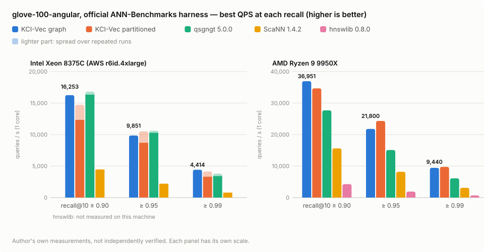

# KCI-Vec — source

**Fast, compact vector search you embed in your application.** The dense index is one C file (`kci_vec.c`) and two headers (`kci_vec.h`, `kci_crypt.h`); no
dependencies, no server.

*[日本語](README_ja.md)* · **Overview page:** <https://claude.ai/artifact/CCvYMLaDGKzNeFKUBGR69A>

This repository holds the **source** of KCI-Vec (version 0.2.10: cosine, Euclidean (L2) distance and inner product, and an experimental sparse index). The evaluation wheel (a pip-installable binary) is in **[KimYuki3/kci-vec-dist](https://github.com/KimYuki3/kci-vec-dist)**.

---

## At a glance

| | |
|---|---|
| **Embedded** | Runs inside your process. No server, no JVM, nothing to operate |
| **Fast** | On the official ANN-Benchmarks harness, roughly 2–5× ScaNN 1.4.2, and on par with or ahead of qsgngt on the same machines |
| **Compact** | One byte per dimension — about a quarter of float32 |
| **Updatable** | Insert, delete and compact after the build |
| **Flexible queries** | Metadata / permission filtering, hybrid keyword + vector ranking |
| **Encryption if you need it** | Saved indexes can be encrypted (AES-256-CTR) and authenticated (AES-256-CMAC). Optional; costs nothing when unused |

Made for applications that need vector search without running a vector database: shipped inside an app, on a device,
or over data that should not leave the machine.

---

## What you can use it for

| Use | Example | What makes it fit |
|---|---|---|
| **Search inside an application** | Search notes, mail or files by meaning in a desktop or on-device app | No server; it runs in your process. About a quarter of float32's memory |
| **Search that also needs exact words** | Queries with part numbers, names or figures that meaning alone misses | Keyword and vector ranking combined |
| **Search that respects permissions** | Show only the documents a department or role may see | Filtering by a condition on the id |
| **Search and RAG over in-house documents** | Find internal rules, manuals or support history by meaning before an AI answers from them | Nothing has to go to an outside service. The index can be encrypted, with tampering detected |
| **One index per customer** | In a service, give each customer their own index file | An index is one file; if needed, each customer's can be encrypted with its own key |

---

## What is in it

- **Two indexes over int8 vectors** (one byte per dimension):
  - *partitioned* (`kci_vec_build_ivf` / `kci_vec_search_ivf`): k-means lists, 4-bit codes scored with SIMD table
    lookups (32 at a time on AVX2, 64 on AVX-512), probe gap, optional SOAR, float or int8 re-ranking;
  - *graph* (`kci_vec_build` / `kci_vec_search*`): HNSW with integer dot products, ε-radius search
    (`kci_vec_searcher_set_eps`), and an optional quantized layer 0 (`kci_vec_build_qg`) that keeps each node's
    neighbours' 4-bit codes in one block.
- Insert, delete and compact after the build; a filter predicate on ids during search.
- A quick build (`kci_vec_build_fast`, from 0.2.5): builds the graph in less time; it does not reach the quality of the regular build (`kci_vec_build`).
- Optional encrypted saves (AES-256-CTR + AES-256-CMAC; wrong keys and altered files are refused) and a read-only
  image that several processes can map.
- A Python client (`clients/python`, ctypes + NumPy) with a small BM25 index for hybrid keyword + vector ranking.
- An ANN-Benchmarks component (`integrations/ann-benchmarks`).
- A PostgreSQL extension (`pg/`, a prototype, from 0.2.8): see "From PostgreSQL" below.

**New in the source with 0.2.3:** the Euclidean (L2) index (`kci_vec_new_l2`) and the inner-product index (`kci_vec_new_ip`).
The quantized graph now goes into both the read-only image and the encrypted save, so an opened index uses it as it is.

---

## Sparse index and hybrid search (experimental, from 0.2.6)

An index for sparse vectors — documents as weighted terms, as produced by learned models such as SPLADE or by BM25 — is
added as separate files, `kci_sparse.c` / `kci_sparse.h`. It is independent of the dense index (`kci_vec.c`); either can be used alone.

- **What it does**: add, build and search sparse vectors; encrypted save (the same AES-256-CTR + CMAC as the dense index);
  two ways to merge a dense and a sparse result into one ranking (by rank, `kci_hybrid_rrf`; by score, `kci_hybrid_mix`).
  In Python: `kci_vec.sparse` and `kci_vec.hybrid`.
- **Experimental**: function signatures and settings may change. Files written by a published version will stay readable by later versions.
- **Limits**:
  - The grouped search is approximate: the scores it returns are exact, but it can miss some of the top results (tune it with its settings).
  - Rows added after the build (`kci_sparse_insert`) are scored one by one at every query until the index is rebuilt.
  - With a vocabulary of 65,536 terms or more the index is larger and `kci_sparse_drop_rows` (which frees the original rows to save memory) is not available.
  - Little-endian machines only. `global_cut` is for experiments; leave it at 0.
- **Checked on**: Linux (gcc, clang), Windows (MinGW-w64, also as a DLL from Python), x86-64 without AVX2, aarch64 under an emulator.
  Not checked on ARM hardware, macOS or MSVC. There is no SIMD code for ARM; plain C runs there.
- **Handing over texts**: from 0.2.9 `kci_vec.text` (experimental, below) runs the models for you. With the sparse index alone, the model that turns text into sparse vectors is yours to choose and run.

Whether merging helps depends on the data and on how strong the dense model is. nDCG@10 on public judged data, measured once each by the developer
(both sides searched exhaustively, 100 results each, then merged; 648 queries for FiQA, 1,667 for JQaRA).

| data (dense model / sparse model) | dense only | sparse only | merged by rank, equal weights | merged by score (weight chosen on 50 other queries) |
|---|---|---|---|---|
| BEIR FiQA (intfloat/multilingual-e5-small / naver/splade-cocondenser-ensembledistil) | 0.331 | 0.348 | 0.384 | 0.389 |
| JQaRA (cl-nagoya/ruri-v3-30m / hotchpotch/japanese-splade-v2) | 0.584 | 0.606 | 0.633 | 0.643 |
| JQaRA (intfloat/multilingual-e5-small / hotchpotch/japanese-splade-v2) | 0.479 | 0.606 | 0.573 | 0.609 |

As the third row shows, merging with equal weights when the dense side is weak is worse than the sparse side alone. With a chosen weight it is no longer worse, but hardly better (0.606 to 0.609). When one side is
much weaker, replacing its model helps more than tuning the merge (rows 2 and 3 differ only in the dense model). With about 50 judged
queries, `choose_weight` picks the weight (with 20 it sometimes picked a poor one).

---

## Search by handing over texts (`kci_vec.text`, experimental)

No vectors of your own needed: hand over the texts and search them.

    from kci_vec.text import TextIndex

    ix = TextIndex("en")                         # "ja" Japanese, "en" English
    ix.add(["Paid leave: 10 days after six months.", "Expense reports close at the end of the month."])
    for hit in ix.search("how many days of paid leave?", k=3):
        print(hit.id, round(hit.score, 3), hit.text)
    ix.save("my_index", key="passphrase")        # the indexes and the texts are encrypted; later TextIndex.load("my_index", key="passphrase")

- Texts and questions are turned into vectors by two language models that run on this machine (one for the meaning,
  one for the words), and the results of the two searches are merged. After the models have been downloaded once,
  nothing is sent anywhere.
- Long texts are split by themselves. An answer is a text; the part that matched best is `hit.text`, its place
  `hit.span`.
- **Needs**: `pip install torch transformers`; for Japanese also `fugashi unidic-lite`. The first use downloads the
  models (a few hundred MB).
- **Built-in models** (licences as their model pages state them; check for yourself before relying on it):
  Japanese `cl-nagoya/ruri-v3-30m` (Apache-2.0) and `hotchpotch/japanese-splade-v2` (MIT); English
  `intfloat/multilingual-e5-small` (MIT) and `opensearch-project/opensearch-neural-sparse-encoding-v2-distill`
  (Apache-2.0). Your own models can be passed instead (`TextIndex(dense=..., sparse=..., sparse_dim=...)`).
- **The word side without a model** (from 0.2.10): `TextIndex("ja", sparse="bm25")` uses character-pair BM25 for the
  word side instead of the second model. Names, abbreviations and numbers no model has seen are matched as written, and
  adding texts and asking are faster (one model runs instead of two). `dedup=True` is for data in which the same text
  comes many times. `device="auto"` selects a GPU; the author has not tried it on a machine with one.
- **A re-ranker of your own** (from 0.2.10): `ix.candidates(question)` gives what the two searches found before any
  merging (with the place each side gave it); `ix.search(question, rerank=f)` orders them by `f(question, [texts]) ->
  scores`. No re-ranking model is included. With `sparse="bm25"`, `phrase=True` puts the parts in which the question's
  words stand as written first: for short records searched in the records' own words (on the author's data of Japanese
  journal papers it did not improve the results; off by default).
- **Adding texts is slow**: about 4 to 8 texts a second on a CPU (20 to 40 minutes for 10,000). A question takes
  about 0.07 s (Ryzen 7 8845HS).
- **Experimental**: names, arguments and the saved form may change.

Measured (nDCG@10, the author's own measurement, against each data set's judgements): English SciFact (5,183
documents, 300 questions): meaning alone 0.673, words alone 0.729, merged 0.736. Japanese: 637 introductions of journal
papers (JMTEB NLP Journal, median 1,990 characters) searched by the papers' titles, 510 questions: 0.956 / 0.942 / 0.970.
It depends on the data and the models (the same texts searched by the papers' abstracts: 0.990 / 0.959 / 0.983, the
meaning alone slightly ahead). With `sparse="bm25"`: merged 0.959 by titles and 0.991 by abstracts, and adding the
texts took about a tenth of the time (same data, same machine).

## From PostgreSQL (the extension in `pg/`, a prototype)

KCI-Vec can be called from inside PostgreSQL as SQL functions (`CREATE EXTENSION kci_vec_pg`). Usage, the list of
functions and the limits are in `pg/README.md`.

- Changes of the table show in the next search. Searches work on a hot standby. The metric is cosine, L2 or inner
  product. Tested on PostgreSQL 15 / 16 / 17.
- **It is not written like pgvector.** Functions instead of `CREATE INDEX` and `<=>`.
- **It is for a PostgreSQL you run yourself.** Managed services that do not let you install extensions cannot use it.
- The extension's index file is not encrypted (it is protected as PostgreSQL's own table files are).

Against pgvector 0.8.1's HNSW in the same PostgreSQL 16.15, on the same table, through the same SQL round trip
(glove-100, 1.18 M rows, one connection, 10,000 queries, k = 10, Ryzen 7 8845HS, 2026-11-20, minimum to maximum of
three alternating rounds):

| | recall@10 | queries / s |
|---|---|---|
| KCI-Vec (nprobe 64 / rerank 200) | 0.9005 | 3,261–3,906 |
| pgvector HNSW (ef_search 240) | 0.8947 | 199–210 |
| KCI-Vec (nprobe 200 / rerank 600) | 0.9632 | 1,776–2,206 |
| pgvector HNSW (ef_search 1000, its limit) | 0.9612 | 58–59 |

The author's own measurement: one data set, one machine, one connection. L2 and inner-product indexes, several
connections and filtered searches were not measured with this version. This compares the two inside PostgreSQL; do not
combine it with the numbers under "Speed" above. Conditions: `pg/README.md`.

## Options added in 0.2.8

All are off by default; an index that does not ask for them is unchanged.

- **Keeping identical vectors once** (`kci_vec_set_dedup`; `KciVec(dedup=True)` in Python): for data in which the same
  text, or empty text, comes many times. A vector identical to one already there is stored once, and every id is
  remembered. Searches answer with all the ids as before (`kci_vec_searcher_set_unique` gives one id per distinct
  vector instead). Off by default; an index that does not ask is unchanged. A file saved with it cannot be read by
  versions up to 0.2.7 (they refuse it). `kci_vec_dup_stats` (`dup_stats()` in Python) counts how many identical
  vectors your data hold.
- **A search-only index** (`kci_vec_search_only`; `search_only()` in Python): an index that is only searched through
  its quantized graph gives up what those searches do not use, and takes less memory. One way: afterwards it cannot be
  added to, deleted from, saved or rebuilt, so save it first.
- **A memory-first quantized graph** (`kci_vec_build_qg_res`; `build_qg(code_dims=..., residual=True)` in Python): a
  smaller form of the quantized graph. Files and images saved in this form cannot be read by versions up to 0.2.7
  (they refuse them). In the author's own measurement (agnews, 1024 dimensions, one machine), together with the
  search-only index above, the index took about 40 % less memory and recall did not drop. Not yet checked on other
  data or in the VIBE flow.

## Compared with other products

All figures are the author's own measurements and have not been independently verified. Conditions are under *Speed* below. The figures were measured with the evaluation wheel.

**Compared with vector databases that run as a server**
- **Nothing to operate**: a search is a function call inside your process. No server to start, monitor, upgrade or network.
- **Ships with your application**: one library built from one C file, one file per index.
- **No network round trip** per query (a difference in design; not measured here).

**Compared with embedded libraries (ScaNN, hnswlib, …)**
- **Faster**: on the same machines with the same official harness, 2.2–5.3× ScaNN 1.4.2 (partitioned index) and
  8.7–13.8× hnswlib 0.8.0 (graph index; 9950X, hnswlib with a reduced grid) on glove-100 (cosine).
- **Smaller**: one byte per dimension (int8), about a quarter of an index held in float32.
- **All in one**: insert / delete / compact after the build, metadata filtering, keyword (BM25) + vector ranking, and
  encrypted, authenticated saves — without combining separate components.

**Compared with other quantized-graph methods (qsgngt, glass, SymphonyQG, NGT-QG)**
- **glove-100**: against qsgngt, 1–7 % behind at recall 0.90 and 0.95 and 1.16–1.30× at 0.99 on the Xeon; 1.34–1.55× on the 9950X.
- **VIBE, the embedding benchmark (yahoo-minilm-384, k = 100)**: 1.09–1.36× glass, 1.3–1.6× SymphonyQG, 1.4–2.0× NGT-QG
  (Xeon and 9950X; the others measured a day or two before on the same machines).
- **Faster to build**: on one core, about a seventh of qsgngt's build time on glove-100 (1,867 s vs 13,051 s, partitioned
  index, Xeon), and under a quarter of NGT-QG's on VIBE yahoo (249–458 s vs 1,894–3,884 s,
  graph index, Xeon, best-point indexes on both sides).

<picture>
  <source media="(prefers-color-scheme: dark)" srcset="docs/img/vibe_build_en_dark.svg">
  
</picture>

**Where it is weaker**
- The graph index (compact layout) is large: 3.3–4.3× glass's memory on VIBE yahoo (best-point indexes).
- On 1024-dimensional L2 data (VIBE agnews), versions up to 0.2.2 did not reach glass from recall 0.95 up. 0.2.3 does (see Speed below), but its index takes about twice glass's memory.
- On ARM (Apple M2) it builds and the tests pass, but the partitioned index and the quantized graph have no ARM SIMD path and run slower than on x86.

---

## Speed

**These figures were measured with the evaluation wheel ([kci-vec-dist](https://github.com/KimYuki3/kci-vec-dist), up to 0.2.1).**
They have not been re-measured with a library built from this source. The Euclidean (L2) figures are in the kci-vec-dist README.

glove-100-angular (1.18 M × 100), official ANN-Benchmarks harness: k = 10, one CPU core, 10,000 queries, best of 5 runs
per setting. Best QPS at recall@10 ≥ 0.90 / 0.95 / 0.99.

<picture>
  <source media="(prefers-color-scheme: dark)" srcset="docs/img/glove100_qps_en_dark.svg">
  
</picture>

| algorithm | Intel Xeon 8375C (AWS r6id.4xlarge) | AMD Ryzen 9 9950X |
|---|---|---|
| **KCI-Vec — graph** (compact layout, preview) | **16,253 / 9,851 / 4,414** | **36,951 / 21,800 / 9,440** |
| **KCI-Vec — partitioned** | 12,331–14,725 / 8,694–10,493 / 3,302–4,138 | 34,670 / 24,321 / 9,747 |
| qsgngt 5.0.0 (full official config) | 16,339–16,809 / 10,282–10,618 / 3,408–3,789 | 27,678 / 15,089 / 6,099 |
| ScaNN 1.4.2 (full official config) | 4,438–4,508 / 2,190–2,219 / 783–794 | 15,611 / 8,195 / 3,085 |
| hnswlib 0.8.0 | — | 4,268 / 1,898 / 685 |

- Ranges are min–max over repeated runs on the same machine: six runs for KCI-Vec partitioned and ScaNN, three for qsgngt, one otherwise.
- **All figures are the author's own measurements and have not been independently verified.** They are not compared
  with the figures on ann-benchmarks.com, which were taken at another time on other machines.
- Rankings depend on the CPU and the recall target; treat these as specific measurements, not a general ranking.

### Speed on VIBE, the embedding benchmark

[VIBE](https://github.com/vector-index-bench/vibe), official container flow, yahoo-minilm-384-normalized (677 k × 384,
cosine): k = 100, one core for build and search, best of 5 runs per setting. Best QPS at recall@100 ≥ 0.90 / 0.95 / 0.99.
KCI-Vec is wheel 0.2.1.

<picture>
  <source media="(prefers-color-scheme: dark)" srcset="docs/img/vibe_qps_en_dark.svg">
  
</picture>

| algorithm | Intel Xeon 8375C (AWS r6id.4xlarge) | AMD Ryzen 9 9950X |
|---|---|---|
| **KCI-Vec — graph** (compact layout, preview) | **9,669 / 7,934 / 5,336** | **19,267 / 16,074 / 10,900** |
| **KCI-Vec — partitioned** | 7,383 / 6,287 / 2,969 | 18,126 / 13,642 / 5,802 |
| glass | 8,844 / 6,575 / 4,854 | 15,010 / 11,811 / 8,861 |
| SymphonyQG | 7,066 / 6,001 / 3,789 | 12,476 / 10,527 / 6,784 |
| NGT-QG | 6,887 / 4,916 / 3,266 | 11,497 / 8,256 / 5,339 |
| LoRANN | 6,417 / 3,398 / 1,297 | 16,991 / 8,690 / 3,024 |
| ScaNN | 3,203 / 2,057 / 645 | 10,456 / 6,755 / 2,459 |

- One run each, the author's own measurements. The others ran with VIBE's own grids, on the same machines a day or two
  before KCI-Vec.
- **KCI-Vec's grid was widened after looking at results on this dataset** (two dims per code, int8 re-scoring, ef 220 / 250).
- On 1024-dimensional L2 data (agnews-mxbai-1024-euclidean, 9950X) glass was faster than 0.2.1 from recall 0.95 up
  (KCI-Vec graph 9,653 / 6,328 / 3,470, glass 9,875 / 7,425 / 4,693). Measured again with the 0.2.3 source on one night:
  KCI-Vec 12,464 / 9,631 / 5,912, glass 9,877 / 7,378 / 4,961 (2026-11-19, one run; the KCI-Vec settings were chosen by us).
  Index memory: KCI-Vec 5.0-7.4 GB, glass 2.5-3.6 GB.

  

- Not yet submitted to VIBE. Not compared with the figures on vector-index-bench.github.io (another time, other machines).

---

## Method

- It builds on published methods: HNSW, which walks a graph, and a partitioned index with 4-bit codes (the family ScaNN belongs to).
- Vectors are kept in a compressed form, and only the best candidates are re-ordered at full precision at the end.
- The speed comes less from doing fewer computations than from reading memory less often.
- In exchange, the faster method needs a larger index.

### Where it is not ahead

- Memory: the fastest graph settings take 3.3–4.3× glass's memory (VIBE yahoo, Xeon).
- 1024-dimensional L2 data (VIBE agnews): the index takes about twice glass's memory (5.0-7.4 GB against 2.5-3.6 GB).

---

## Build

```sh
sh build_kci_vec.sh          # libkci_vec.a, libkci_vec.so (or .dylib), ./example_kci_vec, libkci_sparse.a and ./example_hybrid
./example_kci_vec
```

Linux and macOS (x86-64 with AVX2 / AVX-512, or ARM64). Windows (MinGW): `gcc -O3 -march=native -shared -static -static-libgcc -o libkci_vec.dll kci_vec.c` (`kci_win_compat.h` supplies the POSIX parts).

## Tests

```sh
gcc -O2 -march=native -I. tests/test_qg.c kci_vec.c -lpthread -lm -o test_qg && ./test_qg
```

Each file in `tests/` has its build line at the top (some include `kci_vec.c` themselves). Python:
`KCI_VEC_LIB=$PWD/libkci_vec.so python3 clients/python/test_smoke.py` and `test_hybrid.py`.

## Use from C

```c
#include "kci_vec.h"

KciVec *v = kci_vec_new(dim, 16, 200);                 /* dim, HNSW M, efConstruction */
for (...) kci_vec_add(v, id, vec);                       /* float32[dim]; normalized inside (cosine) */
kci_vec_build(v, 0, NULL);                               /* graph, all cores */
int n = kci_vec_search(v, query, 10, 100, ids, scores);  /* top 10, ef 100; scores are cosine */
kci_vec_save(v, "index.kv", key, keylen);                /* encrypted when a key is given */
```

**How to use it (Python and C), which settings to start from, and the rules to keep: [docs/API.md](docs/API.md).**
The full API, with what each option does, is commented in `kci_vec.h`. The main figures are in the kci-vec-dist README.

## License

[PolyForm Noncommercial 1.0.0](LICENSE): free for research, education, personal and other non-commercial use.
Commercial use needs a separate license — open an issue in
[kci-vec-dist](https://github.com/KimYuki3/kci-vec-dist/issues) saying so, and a private contact will follow.

Required Notice: Copyright 2026 Yukihiro Kimura (https://github.com/KimYuki3)
