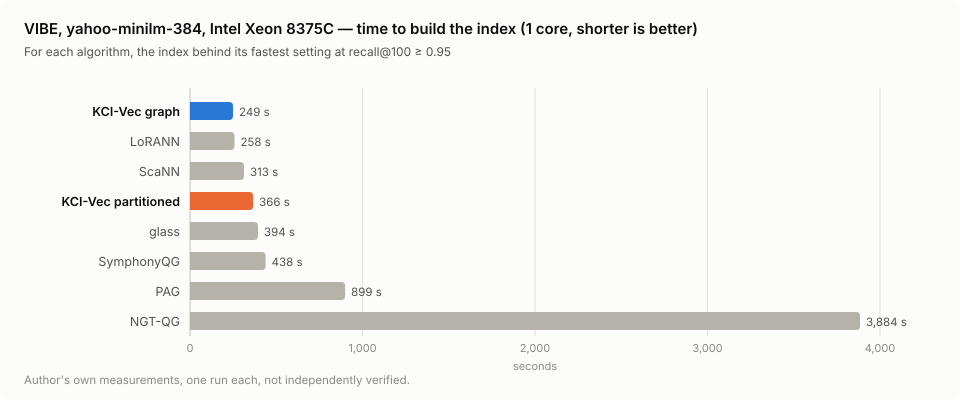
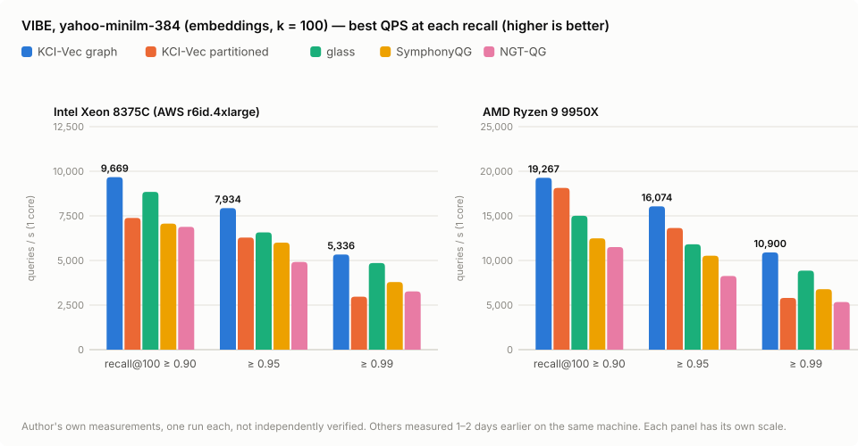

# KCI-Vec — source

**Fast, compact vector search you embed in your application.** One C file (`kci_vec.c` + `kci_vec.h`), no
dependencies, no server.

*[日本語](README_ja.md)* · **Overview page:** <https://claude.ai/artifact/CCvYMLaDGKzNeFKUBGR69A>

This repository holds the **source** of KCI-Vec. The evaluation wheel (a pip-installable binary, which also supports L2 distance) is in **[KimYuki3/kci-vec-dist](https://github.com/KimYuki3/kci-vec-dist)**.

---

## At a glance

| | |
|---|---|
| **Embedded** | Runs inside your process. No server, no JVM, nothing to operate |
| **Fast** | On the official ANN-Benchmarks harness, roughly 2–5× ScaNN 1.4.2, and on par with or ahead of qsgngt on the same machines |
| **Compact** | One byte per dimension — about a quarter of float32 |
| **Updatable** | Insert, delete and compact after the build |
| **Flexible queries** | Metadata / permission filtering, hybrid keyword + vector ranking |
| **Encryption if you need it** | Saved indexes can be encrypted (AES-256-CTR) and authenticated (AES-256-CMAC). Optional; costs nothing when unused |

Made for applications that need vector search without running a vector database: shipped inside an app, on a device,
or over data that should not leave the machine.

---

## What you can use it for

| Use | Example | What makes it fit |
|---|---|---|
| **Search inside an application** | Search notes, mail or files by meaning in a desktop or on-device app | No server; it runs in your process. About a quarter of float32's memory |
| **Search that also needs exact words** | Queries with part numbers, names or figures that meaning alone misses | Keyword and vector ranking combined |
| **Search that respects permissions** | Show only the documents a department or role may see | Filtering by a condition on the id |
| **Search and RAG over in-house documents** | Find internal rules, manuals or support history by meaning before an AI answers from them | Nothing has to go to an outside service. The index can be encrypted, with tampering detected |
| **One index per customer** | In a service, give each customer their own index file | An index is one file; if needed, each customer's can be encrypted with its own key |

---

## What is in it

- **Two indexes over int8 vectors** (one byte per dimension):
  - *partitioned* (`kci_vec_build_ivf` / `kci_vec_search_ivf`): k-means lists, 4-bit codes scored with SIMD table
    lookups (32 at a time on AVX2, 64 on AVX-512), probe gap, optional SOAR, float or int8 re-ranking;
  - *graph* (`kci_vec_build` / `kci_vec_search*`): HNSW with integer dot products, ε-radius search
    (`kci_vec_searcher_set_eps`), and an optional quantized layer 0 (`kci_vec_build_qg`) that keeps each node's
    neighbours' 4-bit codes in one block.
- Insert, delete and compact after the build; a filter predicate on ids during search.
- Optional encrypted saves (AES-256-CTR + AES-256-CMAC; wrong keys and altered files are refused) and a read-only
  image that several processes can map.
- A Python client (`clients/python`, ctypes + NumPy) with a small BM25 index for hybrid keyword + vector ranking.
- An ANN-Benchmarks component (`integrations/ann-benchmarks`).

**Not in this release:** the L2 (Euclidean) index — it is in the evaluation wheel, and its source will follow later;
this source is cosine only.

---

## Compared with other products

All figures are the author's own measurements and have not been independently verified. Conditions are under *Speed* below. The figures were measured with the evaluation wheel.

**Compared with vector databases that run as a server**
- **Nothing to operate**: a search is a function call inside your process. No server to start, monitor, upgrade or network.
- **Ships with your application**: one library built from one C file, one file per index.
- **No network round trip** per query (a difference in design; not measured here).

**Compared with embedded libraries (ScaNN, hnswlib, …)**
- **Faster**: on the same machines with the same official harness, 2.2–5.3× ScaNN 1.4.2 (partitioned index) and
  8.7–13.8× hnswlib 0.8.0 (graph index; 9950X, hnswlib with a reduced grid) on glove-100 (cosine).
- **Smaller**: one byte per dimension (int8), about a quarter of an index held in float32.
- **All in one**: insert / delete / compact after the build, metadata filtering, keyword (BM25) + vector ranking, and
  encrypted, authenticated saves — without combining separate components.

**Compared with other quantized-graph methods (qsgngt, glass, SymphonyQG, NGT-QG)**
- **glove-100**: against qsgngt, 1–7 % behind at recall 0.90 and 0.95 and 1.16–1.30× at 0.99 on the Xeon; 1.34–1.55× on the 9950X.
- **VIBE, the embedding benchmark (yahoo-minilm-384, k = 100)**: 1.09–1.36× glass, 1.3–1.6× SymphonyQG, 1.4–2.0× NGT-QG
  (Xeon and 9950X; the others measured a day or two before on the same machines).
- **Faster to build**: on one core, about a seventh of qsgngt's build time on glove-100 (1,867 s vs 13,051 s, partitioned
  index, Xeon), and under a quarter of NGT-QG's on VIBE yahoo (249–458 s vs 1,894–3,884 s,
  graph index, Xeon, best-point indexes on both sides).

<picture>
  <source media="(prefers-color-scheme: dark)" srcset="docs/img/vibe_build_en_dark.svg">
  
</picture>

**Where it is weaker**
- The graph index (compact layout) is large: 3.3–4.3× glass's memory on VIBE yahoo (best-point indexes).
- On 1024-dimensional L2 data (VIBE agnews), it does not reach glass from recall 0.95 up (L2 is in the evaluation wheel only, not in this source).
- On ARM (Apple M2) it builds and the tests pass, but the partitioned index and the quantized graph have no ARM SIMD path and run slower than on x86.

---

## Speed

**These figures were measured with the evaluation wheel ([kci-vec-dist](https://github.com/KimYuki3/kci-vec-dist), up to 0.2.1).**
They have not been re-measured with a library built from this source. The Euclidean (L2) figures are in the kci-vec-dist README.

glove-100-angular (1.18 M × 100), official ANN-Benchmarks harness: k = 10, one CPU core, 10,000 queries, best of 5 runs
per setting. Best QPS at recall@10 ≥ 0.90 / 0.95 / 0.99.

<picture>
  <source media="(prefers-color-scheme: dark)" srcset="docs/img/glove100_qps_en_dark.svg">
  
</picture>

| algorithm | Intel Xeon 8375C (AWS r6id.4xlarge) | AMD Ryzen 9 9950X |
|---|---|---|
| **KCI-Vec — graph** (compact layout, preview) | **16,253 / 9,851 / 4,414** | **36,951 / 21,800 / 9,440** |
| **KCI-Vec — partitioned** | 12,331–14,725 / 8,694–10,493 / 3,302–4,138 | 34,670 / 24,321 / 9,747 |
| qsgngt 5.0.0 (full official config) | 16,339–16,809 / 10,282–10,618 / 3,408–3,789 | 27,678 / 15,089 / 6,099 |
| ScaNN 1.4.2 (full official config) | 4,438–4,508 / 2,190–2,219 / 783–794 | 15,611 / 8,195 / 3,085 |
| hnswlib 0.8.0 | — | 4,268 / 1,898 / 685 |

- Ranges are min–max over repeated runs on the same machine: six runs for KCI-Vec partitioned and ScaNN, three for qsgngt, one otherwise.
- **All figures are the author's own measurements and have not been independently verified.** They are not compared
  with the figures on ann-benchmarks.com, which were taken at another time on other machines.
- Rankings depend on the CPU and the recall target; treat these as specific measurements, not a general ranking.

### Speed on VIBE, the embedding benchmark

[VIBE](https://github.com/vector-index-bench/vibe), official container flow, yahoo-minilm-384-normalized (677 k × 384,
cosine): k = 100, one core for build and search, best of 5 runs per setting. Best QPS at recall@100 ≥ 0.90 / 0.95 / 0.99.
KCI-Vec is wheel 0.2.1.

<picture>
  <source media="(prefers-color-scheme: dark)" srcset="docs/img/vibe_qps_en_dark.svg">
  
</picture>

| algorithm | Intel Xeon 8375C (AWS r6id.4xlarge) | AMD Ryzen 9 9950X |
|---|---|---|
| **KCI-Vec — graph** (compact layout, preview) | **9,669 / 7,934 / 5,336** | **19,267 / 16,074 / 10,900** |
| **KCI-Vec — partitioned** | 7,383 / 6,287 / 2,969 | 18,126 / 13,642 / 5,802 |
| glass | 8,844 / 6,575 / 4,854 | 15,010 / 11,811 / 8,861 |
| SymphonyQG | 7,066 / 6,001 / 3,789 | 12,476 / 10,527 / 6,784 |
| NGT-QG | 6,887 / 4,916 / 3,266 | 11,497 / 8,256 / 5,339 |
| LoRANN | 6,417 / 3,398 / 1,297 | 16,991 / 8,690 / 3,024 |
| ScaNN | 3,203 / 2,057 / 645 | 10,456 / 6,755 / 2,459 |

- One run each, the author's own measurements. The others ran with VIBE's own grids, on the same machines a day or two
  before KCI-Vec.
- **KCI-Vec's grid was widened after looking at results on this dataset** (two dims per code, int8 re-scoring, ef 220 / 250).
- On 1024-dimensional L2 data (agnews-mxbai-1024-euclidean, 9950X, same day) glass is faster from recall 0.95 up:
  KCI-Vec graph 9,653 / 6,328 / 3,470, glass 9,875 / 7,425 / 4,693.
- Not yet submitted to VIBE. Not compared with the figures on vector-index-bench.github.io (another time, other machines).

---

## Why it is fast, and how it differs from the others

**None of the building blocks is new.** HNSW graphs, 4-bit codes scored with table lookups ("fast scan"), ScaNN's
anisotropic loss and NGT's ε search are all published. What KCI-Vec does differently is how it puts them together, in
one C file with no dependencies, and the many small changes made wherever profiling showed time being lost. The gains
quoted below are the author's own measurements (machine and number of runs given each time).

### What is different from the others

| | KCI-Vec | the others |
|---|---|---|
| **What it stores** | int8, one byte per dimension (about a quarter of float32). Distances are integer dot products (AVX2, AVX-512, NEON SDOT) | hnswlib keeps float32 vectors |
| **One step in the graph** | Each node of the bottom layer holds **one block**: its neighbour ids and the neighbours' 4-bit codes, side by side. One read scores all neighbours with table lookups | hnswlib fetches each neighbour's vector from a different place in memory. SymphonyQG and NGT-QG also keep neighbours' codes with the node (the idea is theirs too); KCI-Vec uses 4-bit fast-scan codes in a fixed 32-slot layout |
| **When to stop** | Keep the result set small (10–30) and continue only while a candidate is within (1 + ε) of the current bound | HNSW libraries usually grow the candidate list (ef). NGT's search-range coefficient ε is a similar idea |
| **Partitioned index** | Close to ScaNN in design. The number of groups probed changes with each query (*probe gap*), and the candidate handling was rewritten after profiling | ScaNN probes a fixed number of groups |
| **Form** | One C file; runs inside your application. Graph and partitioned indexes in the same library, with insert, delete, filters and encrypted saves | hnswlib, glass, NGT and ScaNN are C++ libraries, most used from Python |

### The changes that made it fast

1. **Read less memory.** int8 rows are a quarter of float32. A float copy (optional) re-ranks only the final
   candidates and can stay in a memory-mapped file, so only the codes and the graph need to be in RAM.
2. **Estimate first, compute exactly later.** For each query small lookup tables are built, and the CPU's byte-shuffle
   instruction scores 32 (AVX2) or 64 (AVX-512) codes at a time. Only candidates whose estimate beats the current
   bound are looked at further.
3. **One block per hop** (quantized bottom layer, `kci_vec_build_qg`). Details that each gave a measurable gain:
   - the bound test on 8 estimates at a time, producing a bit mask;
   - a bucket queue instead of a heap for the candidates;
   - reading ahead (prefetching) the block of the candidate most likely to be visited next: **+31–37 %**;
   - since 0.2.1, a half-size block for the leftover slots. With M = 8 at 384 dimensions the block shrinks from
     6,272 to 3,200 bytes, and QPS rose **1.28–1.58×** with identical results (Ryzen 7 5800H, three alternating rounds).
4. **Stop early** (ε-radius, `kci_vec_searcher_set_eps`), together with reading ahead the "already visited" marks of all
   neighbours (+7–8 %, three alternating rounds): **2.0–2.1×** the QPS of plain ef search on the same graph
   (glove-100, Ryzen 9 9950X, one core, one run).
5. **Partitioned index** (`kci_vec_build_ivf`): profiling showed the table lookups took only about a third of the scan
   time, and cache misses on ids and heap traffic about as much again, so that part was rewritten. On
   1024-dimensional data the codes cover only the top principal directions (*code dims*), which helped most there.

### What was tried and did not help

- Leaving pruned neighbour slots empty (as hnswlib does): 19–35 % less build time, but lower recall at every setting.
- A three-stage coarse filter (4-bit, then int8, then float): about 0.6× the speed, because the random reads cost more
  than they saved.
- Low-rank estimates per group (in the style of LoRANN): −24 % on yahoo.

### Where it is not ahead

- Memory: the fastest graph settings take 3.3–4.3× glass's memory (VIBE yahoo, Xeon).
- 1024-dimensional L2 data (VIBE agnews): glass is faster from recall 0.95 up.

---

## Build

```sh
sh build_kci_vec.sh          # libkci_vec.a, libkci_vec.so (or .dylib) and ./example_kci_vec
./example_kci_vec
```

Linux and macOS (x86-64 with AVX2 / AVX-512, or ARM64). Windows (MinGW): `gcc -O3 -march=native -shared -static -static-libgcc -o libkci_vec.dll kci_vec.c` (`kci_win_compat.h` supplies the POSIX parts).

## Tests

```sh
gcc -O2 -march=native -I. tests/test_qg.c kci_vec.c -lpthread -lm -o test_qg && ./test_qg
```

Each file in `tests/` has its build line at the top (some include `kci_vec.c` themselves). Python:
`KCI_VEC_LIB=$PWD/libkci_vec.so python3 clients/python/test_smoke.py` and `test_hybrid.py`.

## Use from C

```c
#include "kci_vec.h"

KciVec *v = kci_vec_new(dim, 16, 200);                 /* dim, HNSW M, efConstruction */
for (...) kci_vec_add(v, id, vec);                       /* float32[dim]; normalized inside (cosine) */
kci_vec_build(v, 0, NULL);                               /* graph, all cores */
int n = kci_vec_search(v, query, 10, 100, ids, scores);  /* top 10, ef 100; scores are cosine */
kci_vec_save(v, "index.kv", key, keylen);                /* encrypted when a key is given */
```

The full API, with what each option does and the measurements behind the defaults, is commented in `kci_vec.h`.
Comments in `kci_vec.c` refer to measurement records (`bench/results_*.txt`) that are not part of this release; the
figures that matter are in the kci-vec-dist README.

## License

[PolyForm Noncommercial 1.0.0](LICENSE): free for research, education, personal and other non-commercial use.
Commercial use needs a separate license — open an issue in
[kci-vec-dist](https://github.com/KimYuki3/kci-vec-dist/issues) saying so, and a private contact will follow.

Required Notice: Copyright 2026 Yukihiro Kimura (https://github.com/KimYuki3)
