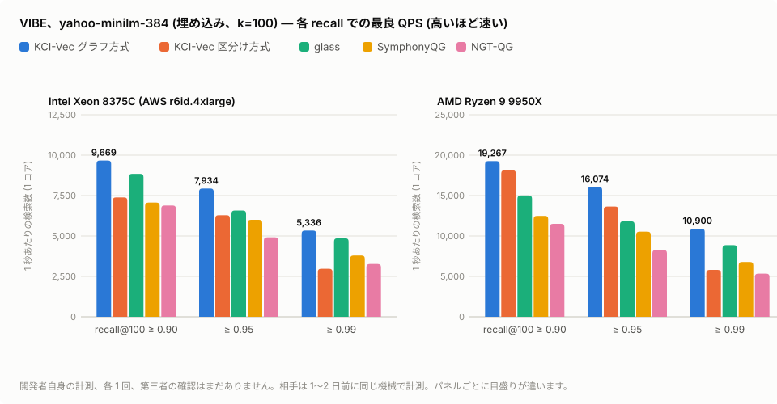

# KCI-Vec — ソース

**アプリに組み込む、速くて軽いベクトル検索。** C の 1 ファイル (`kci_vec.c`) とヘッダ 2 つ (`kci_vec.h`、`kci_crypt.h`)、依存なし、サーバ不要。

*[English](README.md)* · **紹介ページ:** <https://claude.ai/artifact/CCvYMLaDGKzNeFKUBGR69A#ja>

このリポジトリは KCI-Vec の **ソース** です (版 0.2.4。cosine・ユークリッド (L2) 距離・内積)。評価用の wheel (pip で入る実行ファイル) は
**[KimYuki3/kci-vec-dist](https://github.com/KimYuki3/kci-vec-dist)** にあります。

---

## ひと目で

| | |
|---|---|
| **組み込み** | アプリのプロセスの中で動きます。サーバも JVM も、運用の手間もありません |
| **速い** | 公式 ANN-Benchmarks の手順で ScaNN 1.4.2 の約 2〜5 倍。qsgngt とも、同じ機械で並ぶか上回ります |
| **軽い** | 1 次元 1 バイト。float32 の約 4 分の 1 のメモリで動きます |
| **更新できる** | 作ったあとも追加・削除・詰め直しができます |
| **探し方を足せる** | 属性・権限での絞り込み、キーワードとベクトルを合わせた順位付け |
| **暗号化もできる** | 要るときだけ。保存する索引を AES-256-CTR で暗号化し、AES-256-CMAC で改ざんを検出します。使わなければ手間も費用もかかりません |

検索のためだけにベクトル DB を立てて運用したくない場合に向いています。アプリに入れて配る、手元の端末で動かす、データを外に出さずに探す、
といった使い方です。

---

## 利用できる用途

| 用途 | 例 | 生きる性質 |
|---|---|---|
| **アプリの中の検索** | デスクトップや端末のアプリで、メモ・メール・ファイルを意味で探す | サーバが要らず、プロセスの中で動く。メモリは float32 の約 4 分の 1 |
| **言葉の一致も要る検索** | 品番・人名・数字のように、意味だけでは拾えない語を含む問い | キーワードとベクトルを合わせた順位付け |
| **権限に合わせた検索** | 部署や役職で見てよい文書だけを結果に出す | id に対する条件での絞り込み |
| **社内の文書の検索・RAG** | 社内規程や手順書、問い合わせの履歴を、AI に答えさせる前に意味で探す | 外部のサービスに送らずに済む。要るなら索引を暗号化し、改ざんを検出できる |
| **利用者ごとに分けた索引** | サービスで、お客さまごとに索引のファイルを分ける | 索引は 1 つのファイル。要るなら、お客さまごとに別の鍵で暗号化できる |

---

## 入っているもの

- **int8 のベクトル (1 次元 1 バイト) の上の 2 つの索引**:
  - *区分け方式* (`kci_vec_build_ivf` / `kci_vec_search_ivf`): k-means で分けたかたまり、4 ビット符号を SIMD の表引きで
    見積もる (AVX2 で 32 個、AVX-512 で 64 個ずつ)、probe gap、SOAR (選択肢)、float か int8 での並べ直し。
  - *グラフ方式* (`kci_vec_build` / `kci_vec_search*`): 整数の内積で動く HNSW、ε 半径の探索 (`kci_vec_searcher_set_eps`)、
    最下層を「近傍の 4 ビット符号の塊」として持つ量子化グラフ (`kci_vec_build_qg`、選択肢)。
- 作った後の追加・削除・詰め直し、検索中の id への条件での絞り込み。
- 暗号化した保存 (AES-256-CTR + AES-256-CMAC。鍵違いや書き換えられたファイルは読み込まない。選択肢)、
  いくつものプロセスで共有できる読み取り専用の像。
- Python の包み (`clients/python`、ctypes + NumPy)。キーワードとベクトルを合わせる小さな BM25 付き。
- ANN-Benchmarks の部品 (`integrations/ann-benchmarks`)。

**版 0.2.3 から入ったもの:** ユークリッド (L2) 距離の索引 (`kci_vec_new_l2`) と内積の索引 (`kci_vec_new_ip`) のソース。
量子化グラフは、読み取り専用の像と暗号化した保存の両方に入るようになり、開いた索引でそのまま使えます。

---

## ほかの製品と比べて

数字はどれも開発者自身の計測で、第三者による確認はまだありません。条件は下の「速さ」の節にあります。数字は評価用の wheel で測ったものです。

**サーバとして動くベクトル DB と比べて**
- **運用するものが無い**: 検索はプロセスの中の関数呼び出しです。サーバの立ち上げ・監視・更新・ネットワークの設定が要りません。
- **アプリと一緒に配れる**: ライブラリは C の 1 ファイルから作る 1 つ、索引は 1 つのファイルです。
- **通信の往復が無い**: 質問のたびにネットワークを通りません (仕組みの違いで、ここでは測っていません)。

**組み込みのライブラリ (ScaNN、hnswlib など) と比べて**
- **速い**: 同じ機械・同じ公式の手順で、glove-100 (cosine) では区分け方式で ScaNN 1.4.2 の 2.2〜5.3 倍、グラフ方式で hnswlib 0.8.0 の
  8.7〜13.8 倍 (9950X。hnswlib は設定の組を減らして計測)。
- **メモリが小さい**: ベクトルは 1 次元 1 バイト (int8) で、float32 で持つ索引の約 4 分の 1 です。
- **1 つで揃う**: 作ったあとの追加・削除・詰め直し、属性での絞り込み、キーワード (BM25) との組み合わせ、暗号化と改ざん検出つきの保存を、
  別の部品を組み合わせずに使えます。

**量子化グラフの仲間 (qsgngt、glass、SymphonyQG、NGT-QG) と比べて**
- **glove-100**: qsgngt に対して、Xeon では recall 0.90・0.95 で 1〜7 % 下、0.99 で 1.16〜1.30 倍。9950X では 1.34〜1.55 倍。
- **埋め込みの VIBE (yahoo-minilm-384、k=100)**: glass の 1.09〜1.36 倍、SymphonyQG の 1.3〜1.6 倍、NGT-QG の 1.4〜2.0 倍 (Xeon と 9950X。相手は 1〜2 日前に同じ機械で測った値)。
- **作るのが速い**: 1 コアで索引を作る時間は、glove-100 で qsgngt の約 7 分の 1 (1,867 秒 対 13,051 秒、区分け方式、Xeon)、
  VIBE の yahoo で NGT-QG の 4 分の 1 以下 (249〜458 秒 対 1,894〜3,884 秒、グラフ方式、Xeon、どちらも最良点の索引)。

<picture>
  <source media="(prefers-color-scheme: dark)" srcset="docs/img/vibe_build_ja_dark.svg">
  
</picture>

**弱いところも書いておきます**
- グラフ方式 (詰めた配置) の索引は大きく、VIBE の yahoo では最良点の索引どうしで glass の 3.3〜4.3 倍のメモリを使います。
- 1024 次元の L2 のデータ (VIBE の agnews) では、0.2.2 までは recall 0.95 から上で glass に届いていませんでした。0.2.3 では上回りましたが (下の「速さ」)、索引のメモリは glass の約 2 倍です。
- ARM (Apple M2) では組み立てと試験は通りますが、区分け方式と量子化グラフには ARM 用の SIMD の道が無く、x86 より遅くなります。

---

## 速さ

**ここの数字は、評価用の wheel ([kci-vec-dist](https://github.com/KimYuki3/kci-vec-dist)、0.2.1 まで) で測ったものです。**
このソースから組み立てたライブラリでは測り直していません。ユークリッド (L2) 距離の数字は kci-vec-dist の README にあります。

glove-100-angular (118 万件 × 100 次元)、公式 ANN-Benchmarks の手順 (k=10、1 コア、質問 1 万、各設定 5 回の最速)。
recall@10 が 0.90 / 0.95 / 0.99 以上での最良 QPS (1 秒あたりの検索数) です。

<picture>
  <source media="(prefers-color-scheme: dark)" srcset="docs/img/glove100_qps_ja_dark.svg">
  
</picture>

| 算法 | Intel Xeon 8375C (AWS r6id.4xlarge) | AMD Ryzen 9 9950X |
|---|---|---|
| **KCI-Vec グラフ方式** (詰めた配置、先行版) | **16,253 / 9,851 / 4,414** | **36,951 / 21,800 / 9,440** |
| **KCI-Vec 区分け方式** | 12,331〜14,725 / 8,694〜10,493 / 3,302〜4,138 | 34,670 / 24,321 / 9,747 |
| qsgngt 5.0.0 (公式の全設定) | 16,339〜16,809 / 10,282〜10,618 / 3,408〜3,789 | 27,678 / 15,089 / 6,099 |
| ScaNN 1.4.2 (公式の全設定) | 4,438〜4,508 / 2,190〜2,219 / 783〜794 | 15,611 / 8,195 / 3,085 |
| hnswlib 0.8.0 | — | 4,268 / 1,898 / 685 |

- 幅のある値は、同じ機械で繰り返した計測の最小〜最大です。KCI-Vec 区分け方式と ScaNN は 6 回、qsgngt は 3 回、それ以外は 1 回です。
- **すべて開発者自身の計測で、第三者による確認はまだありません。** ann-benchmarks.com の数字とは比べていません (時期も機械も違うため)。
- 順位は CPU と目標の recall で変わります。一般的な順位ではなく、特定の条件での計測としてご覧ください。

### 埋め込みのベンチマーク VIBE での速さ

[VIBE](https://github.com/vector-index-bench/vibe) の公式のコンテナの流れで、yahoo-minilm-384-normalized (67.7 万件 × 384 次元、cosine)。
k=100、索引作りも検索も 1 コア、各設定 5 回の最速。recall@100 が 0.90 / 0.95 / 0.99 以上での最良 QPS です。KCI-Vec は wheel 0.2.1 です。

<picture>
  <source media="(prefers-color-scheme: dark)" srcset="docs/img/vibe_qps_ja_dark.svg">
  
</picture>

| 算法 | Intel Xeon 8375C (AWS r6id.4xlarge) | AMD Ryzen 9 9950X |
|---|---|---|
| **KCI-Vec グラフ方式** (詰めた配置、先行版) | **9,669 / 7,934 / 5,336** | **19,267 / 16,074 / 10,900** |
| **KCI-Vec 区分け方式** | 7,383 / 6,287 / 2,969 | 18,126 / 13,642 / 5,802 |
| glass | 8,844 / 6,575 / 4,854 | 15,010 / 11,811 / 8,861 |
| SymphonyQG | 7,066 / 6,001 / 3,789 | 12,476 / 10,527 / 6,784 |
| NGT-QG | 6,887 / 4,916 / 3,266 | 11,497 / 8,256 / 5,339 |
| LoRANN | 6,417 / 3,398 / 1,297 | 16,991 / 8,690 / 3,024 |
| ScaNN | 3,203 / 2,057 / 645 | 10,456 / 6,755 / 2,459 |

- どれも 1 回ずつの、開発者自身の計測です。相手は VIBE 公式の設定の組そのままで、KCI-Vec の 1〜2 日前に同じ機械で測りました。
- **KCI-Vec の設定の組は、このデータの結果を見ながら足したものです** (2 次元 1 符号、int8 での並べ直し、ef 220・250 など)。
- 1024 次元の L2 のデータ (agnews-mxbai-1024-euclidean、9950X) は、0.2.1 では recall 0.95 から上で glass が速いデータでした
  (KCI-Vec グラフ方式 9,653 / 6,328 / 3,470、glass 9,875 / 7,425 / 4,693)。0.2.3 のソースで同じ夜に測り直すと
  KCI-Vec 12,464 / 9,631 / 5,912、glass 9,877 / 7,378 / 4,961 でした (2026-11-19、1 回の計測。KCI-Vec の設定の組はこちらで選んだもの)。
  索引のメモリは KCI-Vec 5.0〜7.4 GB、glass 2.5〜3.6 GB です。
- VIBE にはまだ登録していません。公開サイト (vector-index-bench.github.io) の数字とは比べていません (時期も機械も違うため)。

---

## なぜ速いか

読むメモリを減らす。正確な計算は後回しにする。早めに止める。この 3 つを、依存のない C の 1 ファイルの中で突き詰めました。
土台は発表済みの手法です (HNSW のグラフ、4 ビットの符号の表引き、ScaNN の異方性の損失、NGT の ε 探索)。

### 勝っていないところ

- メモリ: いちばん速いグラフの設定は、glass の 3.3〜4.3 倍のメモリを使います (VIBE yahoo、Xeon)。
- 1024 次元の L2 データ (VIBE agnews): 索引のメモリは glass の約 2 倍です (5.0〜7.4 GB 対 2.5〜3.6 GB)。

---

## 組み立て

```sh
sh build_kci_vec.sh          # libkci_vec.a、libkci_vec.so (または .dylib)、./example_kci_vec
./example_kci_vec
```

Linux と macOS (AVX2 / AVX-512 のある x86-64、または ARM64)。Windows は MinGW で `gcc -O3 -march=native -shared -static -static-libgcc -o libkci_vec.dll kci_vec.c`
(POSIX の部分は `kci_win_compat.h` が補います)。

## 試験

```sh
gcc -O2 -march=native -I. tests/test_qg.c kci_vec.c -lpthread -lm -o test_qg && ./test_qg
```

`tests/` の各ファイルの頭に組み立て方が書いてあります (`kci_vec.c` を自分で取り込むものもあります)。Python は
`KCI_VEC_LIB=$PWD/libkci_vec.so python3 clients/python/test_smoke.py` と `test_hybrid.py`。

## C からの使い方

```c
#include "kci_vec.h"

KciVec *v = kci_vec_new(dim, 16, 200);                 /* 次元、HNSW の M、efConstruction */
for (...) kci_vec_add(v, id, vec);                       /* float32[dim]。中で正規化 (cosine) */
kci_vec_build(v, 0, NULL);                               /* グラフ、全コア */
int n = kci_vec_search(v, query, 10, 100, ids, scores);  /* 上位 10、ef 100。点数は cosine */
kci_vec_save(v, "index.kv", key, keylen);                /* 鍵を渡せば暗号化 */
```

**使い方 (Python と C)、始めるときの設定、守る決まりは [docs/API_ja.md](docs/API_ja.md) にまとめました。**
API の全体と、各選択肢の意味、既定値の根拠になった計測は `kci_vec.h` の注釈にあります。
`kci_vec.c` の注釈が参照している計測の記録 (`bench/results_*.txt`) は、この版には入っていません。主な数字は kci-vec-dist の README にあります。

## ライセンス

[PolyForm Noncommercial 1.0.0](LICENSE): 研究・教育・個人・その他の非商用の利用は無償です。商用の利用には別の契約が必要です。
[kci-vec-dist](https://github.com/KimYuki3/kci-vec-dist/issues) の Issue に一言書いていただければ、非公開の連絡方法をご案内します。

Required Notice: Copyright 2026 Yukihiro Kimura (https://github.com/KimYuki3)
