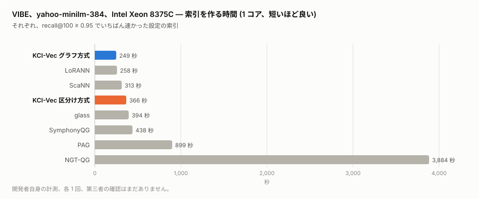
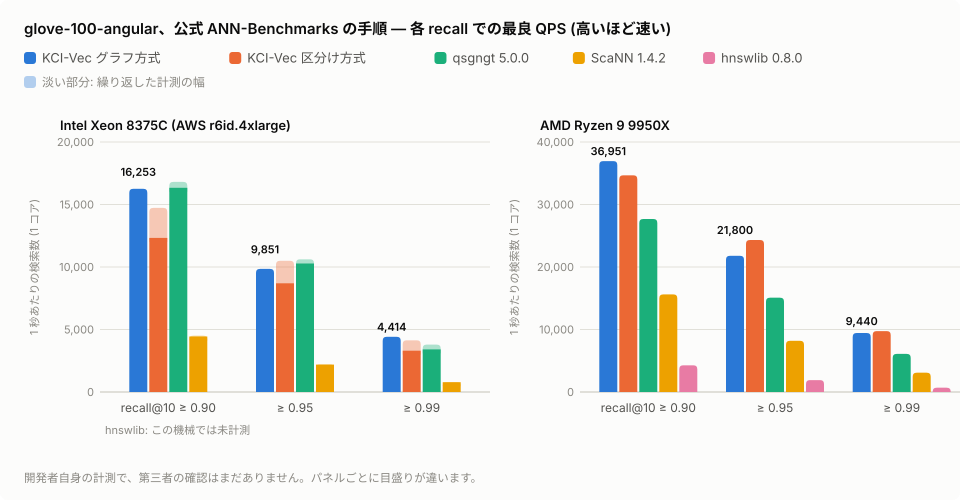
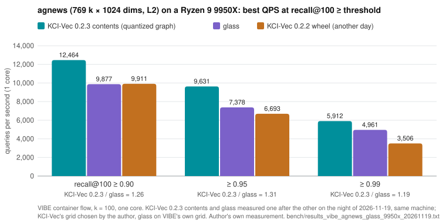

# KCI-Vec — ソース

**アプリに組み込む、速くて軽いベクトル検索。** 密なベクトルの索引は C の 1 ファイル (`kci_vec.c`) とヘッダ 2 つ (`kci_vec.h`、`kci_crypt.h`)。依存なし、サーバ不要。

*[English](README.md)* · **紹介ページ:** <https://claude.ai/artifact/CCvYMLaDGKzNeFKUBGR69A#ja>

このリポジトリは KCI-Vec の **ソース** です (版 0.2.14。cosine・ユークリッド (L2) 距離・内積、実験的なスパースの索引)。評価用の wheel (pip で入る実行ファイル) は
**[KimYuki3/kci-vec-dist](https://github.com/KimYuki3/kci-vec-dist)** にあります。

---

## ひと目で

| | |
|---|---|
| **組み込み** | アプリのプロセスの中で動きます。サーバも JVM も、運用の手間もありません |
| **速い** | 公式 ANN-Benchmarks の手順で ScaNN 1.4.2 の約 2〜5 倍。qsgngt とも、同じ機械で並ぶか上回ります |
| **軽い** | 1 次元 1 バイト。float32 の約 4 分の 1 のメモリで動きます |
| **更新できる** | 作ったあとも追加・削除・詰め直しができます |
| **探し方を足せる** | 属性・権限での絞り込み、キーワードとベクトルを合わせた順位付け |
| **暗号化もできる** | 要るときだけ。保存する索引を AES-256-CTR で暗号化し、AES-256-CMAC で改ざんを検出します。使わなければ手間も費用もかかりません |

検索のためだけにベクトル DB を立てて運用したくない場合に向いています。アプリに入れて配る、手元の端末で動かす、データを外に出さずに探す、
といった使い方です。

---

## 利用できる用途

| 用途 | 例 | 生きる性質 |
|---|---|---|
| **アプリの中の検索** | デスクトップや端末のアプリで、メモ・メール・ファイルを意味で探す | サーバが要らず、プロセスの中で動く。メモリは float32 の約 4 分の 1 |
| **言葉の一致も要る検索** | 品番・人名・数字のように、意味だけでは拾えない語を含む問い | キーワードとベクトルを合わせた順位付け |
| **権限に合わせた検索** | 部署や役職で見てよい文書だけを結果に出す | id に対する条件での絞り込み |
| **社内の文書の検索・RAG** | 社内規程や手順書、問い合わせの履歴を、AI に答えさせる前に意味で探す | 外部のサービスに送らずに済む。要るなら索引を暗号化し、改ざんを検出できる |
| **利用者ごとに分けた索引** | サービスで、お客さまごとに索引のファイルを分ける | 索引は 1 つのファイル。要るなら、お客さまごとに別の鍵で暗号化できる |

---

## 入っているもの

- **int8 のベクトル (1 次元 1 バイト) の上の 2 つの索引**:
  - *区分け方式* (`kci_vec_build_ivf` / `kci_vec_search_ivf`): k-means で分けたかたまり、4 ビット符号を SIMD の表引きで
    見積もる (AVX2 で 32 個、AVX-512 で 64 個ずつ)、probe gap、SOAR (選択肢)、float か int8 での並べ直し。
  - *グラフ方式* (`kci_vec_build` / `kci_vec_search*`): 整数の内積で動く HNSW、ε 半径の探索 (`kci_vec_searcher_set_eps`)、
    最下層を「近傍の 4 ビット符号の塊」として持つ量子化グラフ (`kci_vec_build_qg`、選択肢)。
- 作った後の追加・削除・詰め直し、検索中の id への条件での絞り込み。
- 急いで作る選択肢 (`kci_vec_build_fast`、0.2.5 から): グラフを短い時間で作ります。ふつうの作り方 (`kci_vec_build`) の質には届きません。
- 暗号化した保存 (AES-256-CTR + AES-256-CMAC。鍵違いや書き換えられたファイルは読み込まない。選択肢)、
  いくつものプロセスで共有できる読み取り専用の像。
- Python の包み (`clients/python`、ctypes + NumPy)。キーワードとベクトルを合わせる小さな BM25 付き。
- ANN-Benchmarks の部品 (`integrations/ann-benchmarks`)。
- PostgreSQL の拡張 (`pg/`、試作、0.2.8 から)。下の「PostgreSQL から使う」の節。

**版 0.2.3 から入ったもの:** ユークリッド (L2) 距離の索引 (`kci_vec_new_l2`) と内積の索引 (`kci_vec_new_ip`) のソース。
量子化グラフは、読み取り専用の像と暗号化した保存の両方に入るようになり、開いた索引でそのまま使えます。

---

## スパースの索引とハイブリッド検索 (実験的、0.2.6 から)

語ごとの重みで文書を表すスパースなベクトル (SPLADE などの学習済みモデルや BM25 の出力) の索引を、別のファイル
`kci_sparse.c` / `kci_sparse.h` として足しました。密なベクトルの索引 (`kci_vec.c`) とは独立した部品で、片方だけでも使えます。

- **できること**: スパースなベクトルの追加・索引づくり・検索、暗号化した保存 (密の索引と同じ AES-256-CTR + CMAC)、
  密の結果とスパースの結果を 1 つの順位に合わせる 2 通り (順位で合わせる `kci_hybrid_rrf`、点数で合わせる `kci_hybrid_mix`)。
  Python は `kci_vec.sparse` と `kci_vec.hybrid`。
- **実験的です**: 関数の形と設定は今後変わることがあります。公開した版が書いたファイルは、後の版でも読めるようにします。
- **制限**:
  - まとまりを使う探し方は近似です。返る点数は正確ですが、上位を取りこぼすことがあります (設定で調整します)。
  - 作ったあとに足した行 (`kci_sparse_insert`) は、作り直すまで毎回総当たりで測ります。
  - 語彙が 65,536 以上のときは、索引が大きくなり、`kci_sparse_drop_rows` (元の行を手放してメモリを減らす) は使えません。
  - little-endian の機械だけです。`global_cut` は実験用で、0 のままにしてください。
- **確かめた環境**: Linux (gcc、clang)、Windows (MinGW-w64。DLL と Python からも)、AVX2 の無い x86-64、エミュレータ上の aarch64。
  ARM の実機、macOS、MSVC では確かめていません。ARM 用の SIMD のコードは無く、素の C で動きます。
- **文章を渡すだけで使うには**: 0.2.9 からの `kci_vec.text` (実験的、下の節) がモデルを動かします。スパースの索引だけを使うときは、文章をスパースなベクトルにするモデルを利用者が選んで用意します。

合わせると良くなるかは、データと、密の側のモデルの強さで変わります。公開されている判定つきのデータで、開発者が各 1 回測った nDCG@10 です
(どちらの側も総当たりで 100 件ずつ取って合わせた値。質問は FiQA 648、JQaRA 1,667)。

| データ (密のモデル / スパースのモデル) | 密だけ | スパースだけ | 順位で対等に合わせる | 点数で合わせる (重みは別の 50 問で選ぶ) |
|---|---|---|---|---|
| BEIR FiQA (intfloat/multilingual-e5-small / naver/splade-cocondenser-ensembledistil) | 0.331 | 0.348 | 0.384 | 0.389 |
| JQaRA (cl-nagoya/ruri-v3-30m / hotchpotch/japanese-splade-v2) | 0.584 | 0.606 | 0.633 | 0.643 |
| JQaRA (intfloat/multilingual-e5-small / hotchpotch/japanese-splade-v2) | 0.479 | 0.606 | 0.573 | 0.609 |

3 行めのように、密の側が弱いときに対等に合わせると、スパースだけより悪くなります。重みを選べば下回りませんが、得はほとんどありません (0.606 → 0.609)。片側がずっと弱いときは、合わせ方を工夫するより、
弱い側のモデルを替えるほうが効きます (2 行めと 3 行めの違いは密のモデルだけです)。重みは、判定つきの質問が 50 問ほどあれば
`choose_weight` で決められます (20 問では、外れた重みを選ぶことがありました)。

---

## 文章を渡すだけで探す (`kci_vec.text`、実験的)

はじめての方向けの手順は [docs/quickstart_text_ja.md](docs/quickstart_text_ja.md) にあります (入れる所から、保存して開き直す所まで)。

ベクトルを自分で用意しなくても、文章を渡せば探せます。

    from kci_vec.text import TextIndex

    ix = TextIndex("ja")                         # "ja" 日本語、"en" 英語
    ix.add(["有給休暇は入社半年後に10日付与されます。", "経費の精算は月末締めです。"])
    for hit in ix.search("有給は何日もらえる?", k=3):
        print(hit.id, round(hit.score, 3), hit.text)
    ix.save("my_index", key="passphrase")        # 索引も文章も暗号化して保存。あとで TextIndex.load("my_index", key="passphrase")

- 文章と質問は、この機械の中で動く 2 つの言語モデルでベクトルに直します (意味を見るものと、言葉を見るもの)。
  2 つの検索の結果を合わせて返します。モデルを最初に取ってきたあとは、外に何も送りません。
- 長い文章は自動で分けて入れます。答えは文章の単位で、一番合った部分が `hit.text`、その場所が `hit.span` です。
- **要るもの**: `pip install torch transformers`。日本語はさらに `fugashi unidic-lite`。最初に使うときにモデルを取ってきます (数百 MB)。
- **既定のモデル** (各モデルのページの表示によるライセンス。使う前に自分でも確かめてください):
  日本語 `cl-nagoya/ruri-v3-30m` (Apache-2.0) と `hotchpotch/japanese-splade-v2` (MIT)、
  英語 `intfloat/multilingual-e5-small` (MIT) と `opensearch-project/opensearch-neural-sparse-encoding-v2-distill` (Apache-2.0)。
  自分のモデルを使うこともできます (`TextIndex(dense=..., sparse=..., sparse_dim=...)`)。
- **言葉の側をモデルなしにする** (0.2.10 から): `TextIndex("ja", sparse="bm25")`。言葉を見る側に、モデルの代わりに文字の一致 (BM25) を使います。
  モデルが知らない名前・略語・番号を書かれたとおりに探せて、文章を入れるのも質問も速くなります (動かすモデルが 1 つになります)。
  同じ文が何度も出てくるデータには `dedup=True`。GPU は `device="auto"` で指定できますが、開発者は GPU のある機械で確かめていません。
- **自分の選び直しを挟む** (0.2.10 から): `ix.candidates(質問)` は、2 つの検索の候補を合わせる前のまま (どちらの側が何番めに見つけたか付きで) 返します。
  `ix.search(質問, rerank=f)` は、`f(質問, [本文]) -> 点数` で候補を並べ直します。選び直しのモデルは入っていません。
  `sparse="bm25"` のときの `phrase=True` は、質問の語がそのまま書いてある部分を上に並べます。短い記録を、記録と同じ言葉で探すデータ向けです
  (開発者の測った日本語の論文と質問応答のデータでは良くなりませんでした。既定はオフです)。数えたくない語は `phrase_stop=[...]` か `phrase_common=割合` で外せます (0.2.11 から)。
  `ix.search(質問, rerank=f, select=g)` は、選び直しのあとの上位を `g(質問, [本文]) -> 役立つ順の位置` に見せ、選ばれたものを先頭に置きます (0.2.11 から。
  点数ではなく順番を選ぶ係、たとえば番号つきの一覧を見せた生成のモデル向け)。
- **文章を入れるのは遅いです**: CPU だけで 1 秒に 4〜8 件ほど (1 万件で 20〜40 分)。探すのは質問 1 つ 0.07 秒ほどです (Ryzen 7 8845HS)。
- **実験的です**: 関数の名前・引数・保存の形は変わることがあります。

測った値 (nDCG@10、開発者自身の計測、各データ付属の正解): 英語 SciFact (文書 5,183、質問 300) で、意味だけ 0.673、言葉だけ 0.729、
合わせて 0.736。日本語の論文の導入部 637 件 (JMTEB の NLP Journal、中央値 1,990 字) を論文の題名で探す 510 問で、0.956 / 0.942 / 0.970。
データとモデルの組み合わせで変わります (同じデータを論文の要旨で探すと 0.990 / 0.959 / 0.983 で、意味だけのほうがわずかに上でした)。
`sparse="bm25"` では、題名で探すと合わせて 0.959、要旨で探すと 0.991 で、文章を入れる時間は約 10 分の 1 でした (同じデータ、同じ機械)。

## PostgreSQL から使う (拡張 `pg/`、試作)

KCI-Vec を PostgreSQL の中から SQL の関数で呼べます (`CREATE EXTENSION kci_vec_pg`)。使い方・関数の一覧・制限は `pg/README_ja.md` にあります。

- 表の更新は次の検索に反映されます。ホットスタンバイでも検索できます。距離は cosine・L2・内積から選べます。PostgreSQL 15 / 16 / 17 で試験しています。
- **pgvector と同じ書き方ではありません。** `CREATE INDEX` と `<=>` ではなく、関数で呼びます。
- **自分で管理する PostgreSQL 向けです。** 拡張を自由に入れられない管理型のサービスでは使えません。
- 拡張が持つ索引のファイルは暗号化していません (PostgreSQL の表のファイルと同じ守られ方です)。

pgvector 0.8.1 の HNSW と、同じ PostgreSQL 16.15・同じ表・同じ SQL の往復で比べた結果 (glove-100、118 万行、1 接続、10,000 問、k = 10、
Ryzen 7 8845HS、2026-11-20、交互に 3 巡の最小〜最大):

| | recall@10 | 問/秒 |
|---|---|---|
| KCI-Vec (nprobe 64 / rerank 200) | 0.9005 | 3,261〜3,906 |
| pgvector HNSW (ef_search 240) | 0.8947 | 199〜210 |
| KCI-Vec (nprobe 200 / rerank 600) | 0.9632 | 1,776〜2,206 |
| pgvector HNSW (ef_search 1000、上限) | 0.9612 | 58〜59 |

開発者自身の計測で、1 つのデータ・1 台の機械・1 接続です。L2・内積の索引、同時の接続、絞り込みは、この版では測っていません。
PostgreSQL の中どうしの比べなので、上の「速さ」の節の数字とは足し合わせません。条件は `pg/README_ja.md` にあります。

## 0.2.14 で変わったこと

- 複数のスレッドで索引を作るときのメモリの読み書きを、決まりどおりの形 (atomic) に直しました。答えと速さは変わりません。
- 試験 `tests/test_learn_qg.c` が、ときどき落ちることがあったのを直しました (試験の作りの問題で、本体の動きは同じです)。

## 0.2.13 で変わったこと

- 大きい索引を保存から読み直すときのメモリを減らしました (Linux)。
- `kci_vec_search_learned` (ef > 0) が、量子化グラフのある索引ではそのグラフをたどるようになりました。
  量子化グラフと学んだ一覧の両方を持つ索引では、0.2.12 までと答えが変わります (前と同じにするには `kci_vec_searcher_set_qg(s, 0)`)。

## 0.2.8 で足した指定

どれも既定はオフで、指定しない索引は今までと変わりません。

- **同じベクトルを 1 回だけ持つ指定** (`kci_vec_set_dedup`、Python は `KciVec(dedup=True)`): 同じ文や空の文が何度も出てくるデータ向けです。
  まったく同じベクトルは索引に 1 回だけ入れ、id はすべて覚えておきます。検索の答えは今までどおり全部の id です
  (`kci_vec_searcher_set_unique` で、同じ内容は 1 件だけにもできます)。既定はオフで、指定しない索引は今までと変わりません。
  この指定で保存したファイルは、0.2.7 までの版では読めません (読み込みを断ります)。
  自分のデータに同じベクトルがどれだけあるかは `kci_vec_dup_stats` (Python は `dup_stats()`) で数えられます。
- **探すだけの索引** (`kci_vec_search_only`、Python は `search_only()`): 量子化グラフで探すだけの索引から、検索が使わない部分を手放してメモリを減らします。
  一方通行です。呼んだあとは追加・削除・保存・作り直しができないので、保存は先に済ませます。
- **メモリを先にした量子化グラフ** (`kci_vec_build_qg_res`、Python は `build_qg(code_dims=..., residual=True)`): 量子化グラフを小さく作る形です。
  この形で保存したファイルとイメージは、0.2.7 までの版では読めません (読み込みを断ります)。
  開発者自身の計測 (agnews、1024 次元、1 台の機械) では、上の「探すだけの索引」と合わせて索引のメモリが約 4 割減り、recall は下がりませんでした。
  ほかのデータと、VIBE の流れでは、まだ確かめていません。

## ほかの製品と比べて

数字はどれも開発者自身の計測で、第三者による確認はまだありません。条件は下の「速さ」の節にあります。数字は評価用の wheel で測ったものです。

**サーバとして動くベクトル DB と比べて**
- **運用するものが無い**: 検索はプロセスの中の関数呼び出しです。サーバの立ち上げ・監視・更新・ネットワークの設定が要りません。
- **アプリと一緒に配れる**: ライブラリは C の 1 ファイルから作る 1 つ、索引は 1 つのファイルです。
- **通信の往復が無い**: 質問のたびにネットワークを通りません (仕組みの違いで、ここでは測っていません)。

**組み込みのライブラリ (ScaNN、hnswlib など) と比べて**
- **速い**: 同じ機械・同じ公式の手順で、glove-100 (cosine) では区分け方式で ScaNN 1.4.2 の 2.2〜5.3 倍、グラフ方式で hnswlib 0.8.0 の
  8.7〜13.8 倍 (9950X。hnswlib は設定の組を減らして計測)。
- **メモリが小さい**: ベクトルは 1 次元 1 バイト (int8) で、float32 で持つ索引の約 4 分の 1 です。
- **1 つで揃う**: 作ったあとの追加・削除・詰め直し、属性での絞り込み、キーワード (BM25) との組み合わせ、暗号化と改ざん検出つきの保存を、
  別の部品を組み合わせずに使えます。

**量子化グラフの仲間 (qsgngt、glass、SymphonyQG、NGT-QG) と比べて**
- **glove-100**: qsgngt に対して、Xeon では recall 0.90・0.95 で 1〜7 % 下、0.99 で 1.16〜1.30 倍。9950X では 1.34〜1.55 倍。
- **埋め込みの VIBE (yahoo-minilm-384、k=100)**: glass の 1.09〜1.36 倍、SymphonyQG の 1.3〜1.6 倍、NGT-QG の 1.4〜2.0 倍 (Xeon と 9950X。相手は 1〜2 日前に同じ機械で測った値)。
- **作るのが速い**: 1 コアで索引を作る時間は、glove-100 で qsgngt の約 7 分の 1 (1,867 秒 対 13,051 秒、区分け方式、Xeon)、
  VIBE の yahoo で NGT-QG の 4 分の 1 以下 (249〜458 秒 対 1,894〜3,884 秒、グラフ方式、Xeon、どちらも最良点の索引)。

<picture>
  <source media="(prefers-color-scheme: dark)" srcset="docs/img/vibe_build_ja_dark.svg">
  
</picture>

**弱いところも書いておきます**
- グラフ方式 (詰めた配置) の索引は大きく、VIBE の yahoo では最良点の索引どうしで glass の 3.3〜4.3 倍のメモリを使います。
- 1024 次元の L2 のデータ (VIBE の agnews) では、0.2.2 までは recall 0.95 から上で glass に届いていませんでした。0.2.3 では上回りましたが (下の「速さ」)、索引のメモリは glass の約 2 倍です。
- ARM (Apple M2) では組み立てと試験は通りますが、区分け方式と量子化グラフには ARM 用の SIMD の道が無く、x86 より遅くなります。

---

## 速さ

**ここの数字は、評価用の wheel ([kci-vec-dist](https://github.com/KimYuki3/kci-vec-dist)、0.2.1 まで) で測ったものです。**
このソースから組み立てたライブラリでは測り直していません。ユークリッド (L2) 距離の数字は kci-vec-dist の README にあります。

glove-100-angular (118 万件 × 100 次元)、公式 ANN-Benchmarks の手順 (k=10、1 コア、質問 1 万、各設定 5 回の最速)。
recall@10 が 0.90 / 0.95 / 0.99 以上での最良 QPS (1 秒あたりの検索数) です。

<picture>
  <source media="(prefers-color-scheme: dark)" srcset="docs/img/glove100_qps_ja_dark.svg">
  
</picture>

| 算法 | Intel Xeon 8375C (AWS r6id.4xlarge) | AMD Ryzen 9 9950X |
|---|---|---|
| **KCI-Vec グラフ方式** (詰めた配置、先行版) | **16,253 / 9,851 / 4,414** | **36,951 / 21,800 / 9,440** |
| **KCI-Vec 区分け方式** | 12,331〜14,725 / 8,694〜10,493 / 3,302〜4,138 | 34,670 / 24,321 / 9,747 |
| qsgngt 5.0.0 (公式の全設定) | 16,339〜16,809 / 10,282〜10,618 / 3,408〜3,789 | 27,678 / 15,089 / 6,099 |
| ScaNN 1.4.2 (公式の全設定) | 4,438〜4,508 / 2,190〜2,219 / 783〜794 | 15,611 / 8,195 / 3,085 |
| hnswlib 0.8.0 | — | 4,268 / 1,898 / 685 |

- 幅のある値は、同じ機械で繰り返した計測の最小〜最大です。KCI-Vec 区分け方式と ScaNN は 6 回、qsgngt は 3 回、それ以外は 1 回です。
- **すべて開発者自身の計測で、第三者による確認はまだありません。** ann-benchmarks.com の数字とは比べていません (時期も機械も違うため)。
- 順位は CPU と目標の recall で変わります。一般的な順位ではなく、特定の条件での計測としてご覧ください。

### 埋め込みのベンチマーク VIBE での速さ

[VIBE](https://github.com/vector-index-bench/vibe) の公式のコンテナの流れで、yahoo-minilm-384-normalized (67.7 万件 × 384 次元、cosine)。
k=100、索引作りも検索も 1 コア、各設定 5 回の最速。recall@100 が 0.90 / 0.95 / 0.99 以上での最良 QPS です。KCI-Vec は wheel 0.2.1 です。

<picture>
  <source media="(prefers-color-scheme: dark)" srcset="docs/img/vibe_qps_ja_dark.svg">
  
</picture>

| 算法 | Intel Xeon 8375C (AWS r6id.4xlarge) | AMD Ryzen 9 9950X |
|---|---|---|
| **KCI-Vec グラフ方式** (詰めた配置、先行版) | **9,669 / 7,934 / 5,336** | **19,267 / 16,074 / 10,900** |
| **KCI-Vec 区分け方式** | 7,383 / 6,287 / 2,969 | 18,126 / 13,642 / 5,802 |
| glass | 8,844 / 6,575 / 4,854 | 15,010 / 11,811 / 8,861 |
| SymphonyQG | 7,066 / 6,001 / 3,789 | 12,476 / 10,527 / 6,784 |
| NGT-QG | 6,887 / 4,916 / 3,266 | 11,497 / 8,256 / 5,339 |
| LoRANN | 6,417 / 3,398 / 1,297 | 16,991 / 8,690 / 3,024 |
| ScaNN | 3,203 / 2,057 / 645 | 10,456 / 6,755 / 2,459 |

- どれも 1 回ずつの、開発者自身の計測です。相手は VIBE 公式の設定の組そのままで、KCI-Vec の 1〜2 日前に同じ機械で測りました。
- **KCI-Vec の設定の組は、このデータの結果を見ながら足したものです** (2 次元 1 符号、int8 での並べ直し、ef 220・250 など)。
- 1024 次元の L2 のデータ (agnews-mxbai-1024-euclidean、9950X) は、0.2.1 では recall 0.95 から上で glass が速いデータでした
  (KCI-Vec グラフ方式 9,653 / 6,328 / 3,470、glass 9,875 / 7,425 / 4,693)。0.2.3 のソースで同じ夜に測り直すと
  KCI-Vec 12,464 / 9,631 / 5,912、glass 9,877 / 7,378 / 4,961 でした (2026-11-19、1 回の計測。KCI-Vec の設定の組はこちらで選んだもの)。
  索引のメモリは KCI-Vec 5.0〜7.4 GB、glass 2.5〜3.6 GB です。

  

- VIBE にはまだ登録していません。公開サイト (vector-index-bench.github.io) の数字とは比べていません (時期も機械も違うため)。

---

## 方式

- 土台は公開されている方式です。グラフをたどる HNSW と、かたまりに分けて 4 ビットの符号で見積もる方式 (ScaNN と同じ系統) の 2 つを持ちます。
- ベクトルは小さく縮めて持ち、最後に上位だけを元の精度で並べ直します。
- 速さは、計算の量よりも、メモリの読み方を減らすことで出しています。
- 代わりに、速いほうの方式は索引が大きくなります。

### 勝っていないところ

- メモリ: いちばん速いグラフの設定は、glass の 3.3〜4.3 倍のメモリを使います (VIBE yahoo、Xeon)。
- 1024 次元の L2 データ (VIBE agnews): 索引のメモリは glass の約 2 倍です (5.0〜7.4 GB 対 2.5〜3.6 GB)。

---

## 組み立て

```sh
sh build_kci_vec.sh          # libkci_vec.a、libkci_vec.so (または .dylib)、./example_kci_vec、libkci_sparse.a、./example_hybrid
./example_kci_vec
```

Linux と macOS (AVX2 / AVX-512 のある x86-64、または ARM64)。Windows は MinGW で `gcc -O3 -march=native -shared -static -static-libgcc -o libkci_vec.dll kci_vec.c`
(POSIX の部分は `kci_win_compat.h` が補います)。

## 試験

```sh
gcc -O2 -march=native -I. tests/test_qg.c kci_vec.c -lpthread -lm -o test_qg && ./test_qg
```

`tests/` の各ファイルの頭に組み立て方が書いてあります (`kci_vec.c` を自分で取り込むものもあります)。Python は
`KCI_VEC_LIB=$PWD/libkci_vec.so python3 clients/python/test_smoke.py` と `test_hybrid.py`。

## C からの使い方

```c
#include "kci_vec.h"

KciVec *v = kci_vec_new(dim, 16, 200);                 /* 次元、HNSW の M、efConstruction */
for (...) kci_vec_add(v, id, vec);                       /* float32[dim]。中で正規化 (cosine) */
kci_vec_build(v, 0, NULL);                               /* グラフ、全コア */
int n = kci_vec_search(v, query, 10, 100, ids, scores);  /* 上位 10、ef 100。点数は cosine */
kci_vec_save(v, "index.kv", key, keylen);                /* 鍵を渡せば暗号化 */
```

**使い方 (Python と C)、始めるときの設定、守る決まりは [docs/API_ja.md](docs/API_ja.md) にまとめました。**
API の全体と、各選択肢の意味は `kci_vec.h` の注釈にあります。主な数字は kci-vec-dist の README にあります。

## ライセンス

[PolyForm Noncommercial 1.0.0](LICENSE): 研究・教育・個人・その他の非商用の利用は無償です。商用の利用には別の契約が必要です。
[kci-vec-dist](https://github.com/KimYuki3/kci-vec-dist/issues) の Issue に一言書いていただければ、非公開の連絡方法をご案内します。

Required Notice: Copyright 2026 Yukihiro Kimura (https://github.com/KimYuki3)
